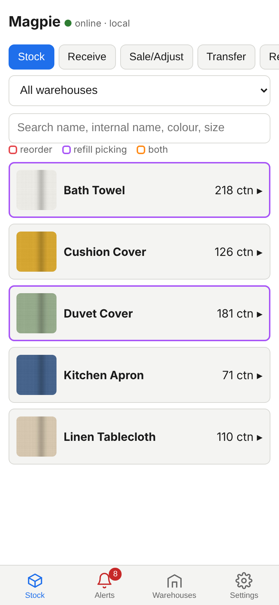
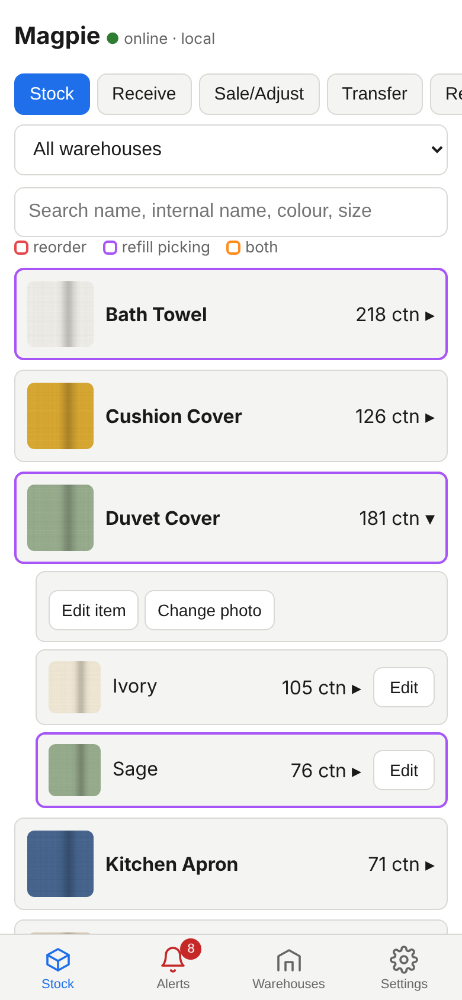
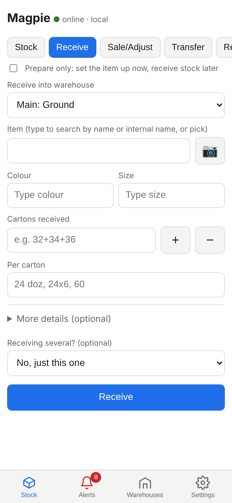
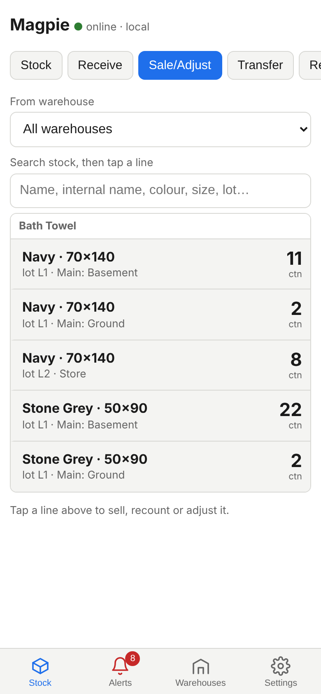
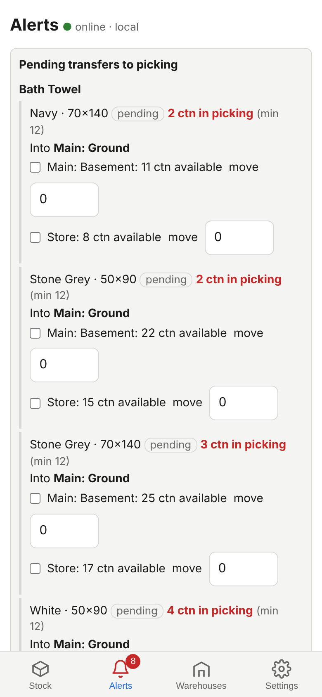
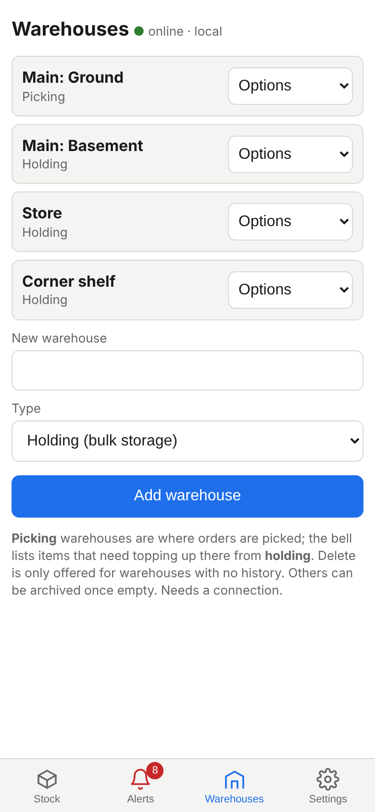

# Magpie

A stock app for a small warehouse, run from your phone. Magpie keeps a record of every carton that comes in, goes out or moves, works offline in the aisles, and syncs when the connection comes back. It runs on your own server and isn't exposed to the internet.

It was built for a textiles wholesaler (items come in colours, sizes and lots, and are counted in cartons), but it fits any stock that's counted in boxes and kept across a few warehouses.

<p align="center">
  
  
  
</p>
<p align="center">
  
  
  
</p>

<sub>The screenshots use made-up demo data. `scripts/screenshots.py` creates them again.</sub>

## What it does

**Stock**
- Items have colours and sizes, and stock is tracked by lot and warehouse. Search matches every word you type, in any order, across name, internal name, colour and size.
- Every item, and optionally every colour, can have a photo.
- Items can be grouped by category, and shown colour-first or size-first.
- Quantities are whole cartons. Each line can also record what's in a carton ("24 doz", "24x6", "60"), so the app can work out pieces.

**Recording movements**
- **Receive**: the cartons field accepts sums such as `32+34+36`, and there's a grid for many colours or sizes at once. You can also set up an item before it arrives ("pending").
- **Read a photo**: photograph a carton label or packing list and Claude fills in the receive form for you. This needs your own Anthropic API key and is optional.
- **Sale, Adjust and Recount**: pick a line, then sell from it, correct it with a note, or type what you counted.
- **Transfer** between warehouses, and **Move** between sections inside one warehouse.
- **Log**: every entry is listed, and any entry can be reversed. Nothing is ever edited or deleted.

**Warehouses**
- Each warehouse is either **picking** (orders are picked from it) or **holding** (bulk storage).
- A warehouse can be split into sections drawn over a photo or plan of the floor. Stock is taken oldest first, and the map shows where each line is.
- Set a picking minimum on an item and the **Alerts** tab lists what to bring over from holding, with how many cartons and from where.
- Reorder levels highlight items that are running low.

**Reports**
- Stock PDFs for chosen items, categories or warehouses, with or without lots and dates. You can share or print them from the phone.
- A year table showing opening stock, received, sold, adjusted, closing stock and sell-through.

**Telegram bot (optional)**
- A read-only bot. Send it any text to look up stock. `/low` lists low stock, and it can post a daily refill list to a group.

**Built to be safe with your data**
- Stock is never stored as a number. It's always worked out from an append-only list of movements, so the history explains every figure.
- It works offline. Entries are queued on the phone, sent once the connection returns, and never applied twice. A sale made offline that takes a line below zero is still accepted (it really happened), but it's flagged.
- A verified backup is made every day (the last 14 are kept), and another one before every database upgrade.

## How it runs

Magpie is a single Docker container: FastAPI and SQLite on the server, one plain HTML/JS file on the phone (a PWA you add to the home screen), and no build step. The container only listens on `127.0.0.1`. Phones reach it over HTTPS through [Tailscale](https://tailscale.com/), so it's only open to your own devices.

The only outbound calls are to the Claude API (when you read a photo) and to Telegram (if you turn the bot on).

## Setup

You need a server that runs Docker (a NAS, Unraid, a Raspberry Pi, a small VPS) and Tailscale on both the server and your phone.

### 1. Start the container

Copy [`docker-compose.yml`](docker-compose.yml) to your server, then edit three things:

| Setting | What to put |
|---|---|
| `volumes` | A folder for the data, for example `/mnt/user/appdata/magpie:/data` on Unraid. Create it first. |
| `TZ` | Your time zone, such as `Europe/London`. It's used for dates in PDFs, the bot and backups. |
| `ALLOWED_LOGINS` | Leave it empty for now (see step 3). |

Then run `docker compose up -d`. On Unraid, install **Compose Manager** from Community Applications, add a stack, paste the file and click **Compose Up**.

Check that it's running:

```
curl http://127.0.0.1:18437/api/health
```

That should print `{"ok":true,...}`.

### 2. Open it on your phone

On the server, run:

```
tailscale serve --bg 18437
```

On older Tailscale versions, run `tailscale serve --bg --https=443 http://localhost:18437` instead.

Then open `https://<server>.<your-tailnet>.ts.net` on the phone. In Safari, tap Share → **Add to Home Screen**. Always open the app from that same address, because offline data is kept per address.

Never use `tailscale funnel`: it would put the app on the public internet.

### 3. Lock it to your login (recommended)

Once the app header shows your Tailscale login, put that login in `ALLOWED_LOGINS` (for example `"yourname@github"`) and start the container again. From then on, only that login, or a device on the server's own network, can get in.

There are two more settings:
- `REQUIRE_TAILSCALE_HEADER: "1"` also refuses any request that doesn't come through Tailscale.
- `ALLOWED_HOSTS` adds extra host names the app answers to. IP addresses, `*.ts.net`, `*.local` and single-word names always work.

### 4. First steps in the app

1. **Warehouses**: rename the starter warehouses, add your own, and mark each one picking or holding. Under **Options** you can add sections and a floor map.
2. **Receive**: add your first items. Receiving 0 cartons registers an item without any stock.
3. **Settings**: optionally add an Anthropic API key for photo reading, and a Telegram bot.

### Photo reading (optional)

Create an API key at [console.anthropic.com](https://console.anthropic.com/) and paste it under **Settings → Photo reading**. It's stored only in `/data` on your server and is never sent back to the phone.

You can set `ANTHROPIC_API_KEY` in the compose file instead. `ANTHROPIC_MODEL` picks the Claude model.

### Telegram bot (optional)

1. In Telegram, message **@BotFather**, send `/newbot` and copy the token.
2. Paste the token under **Settings → Telegram bot**, then message the bot (or add it to a group) and send `/id` to learn your user ID and the group's chat ID.
3. Enter the user IDs allowed to use it, the group ID, and optionally an hour for the daily refill post.

Commands: any text looks up stock, `/stock <words>` does the same, and `/low` lists low stock.

## Updating

Pull the new image and restart: `docker compose pull && docker compose up -d`. On Unraid, use **Compose Pull**, then **Compose Up**. The data folder isn't touched, and database upgrades run on start-up after an automatic backup.

The phone loads the new version the next time it has a connection. If the app is already open, a banner offers **Update now**. Settings shows the app and server versions.

**Rolling back:** images are also tagged by commit (`:sha-abc1234`), so you can change the tag in the compose file. If the update upgraded the database, also restore the matching `backups/pre-vN-*.db`:

1. Stop the container and wait until it has really stopped.
2. Move `stock.db-wal` and `stock.db-shm` out of the data folder, if they're there. They hold the newest changes to the database you're replacing. If you leave them, they would be replayed into the restored copy and corrupt it.
3. Copy the backup over `stock.db`, keeping the old one somewhere safe.
4. Start the container. Backups leave out the API key and bot token, so paste them into Settings again (not needed if they come from the container, see Backups below).

The same steps restore a `daily-*.db` backup.

## Backups
The data folder holds `stock.db`, `photos/`, `maps/` and `backups/`. The built-in backups are on the same disk and cover only `stock.db`, so include the whole folder in a backup to another disk or machine, and test a restore once.

The saved API key and bot token are left out of every backup. They can also be given to the container instead of Settings: `ANTHROPIC_API_KEY` / `TELEGRAM_BOT_TOKEN`, or files named by `ANTHROPIC_API_KEY_FILE` / `TELEGRAM_BOT_TOKEN_FILE` (Docker secrets). A value saved in Settings wins. Files in the data folder are readable by the container's user only (600), so open them as root.

## Development

```
pip install -r requirements-dev.txt
DATA_DIR=./data uvicorn app.main:app --port 8080
python -m pytest -q tests
python tests/check_js.py          # syntax check of the app's script (needs node)
python tests/e2e_smoke.py         # the whole app in a headless browser (pip install playwright requests; playwright install chromium)
python tests/e2e_offline.py       # offline and sync robustness
python scripts/screenshots.py     # rebuild the README screenshots from demo data
```

- Schema changes go at the end of `MIGRATIONS` in `app/db.py`. Never edit an existing migration.
- CI runs the tests on every pull request. On `main`, it builds the image and publishes it to `ghcr.io/<owner>/<repo>`.

## License

[MIT](LICENSE). The bundled [pdf.js](https://github.com/mozilla/pdf.js) viewer in `app/static/vendor/` is Apache-2.0 ([its license](app/static/vendor/pdfjs-LICENSE.txt)).
